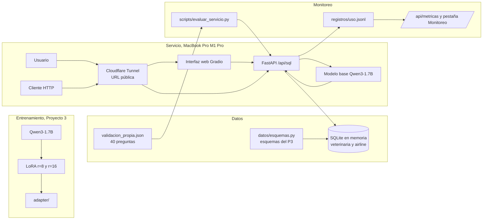

# Texto a SQL en producción

Proyecto Final del curso Deep Learning y Sistemas Inteligentes, Universidad del Valle de Guatemala, segundo semestre 2026. Integrantes: GenserDev, Luisfer2211 y Hugo2049.

Llevamos a producción el modelo de texto a SQL del [Proyecto 3](https://github.com/GenserDev/Deep-P3). El servicio recibe el esquema de una base MySQL y una pregunta en español, genera la consulta con `Qwen/Qwen3-1.7B` y la ejecuta sobre dos bases de demostración. Tiene una API REST, una página web, registro de cada consulta y un panel de monitoreo. Corre en una MacBook Pro M1 Pro y se publica en Internet con Cloudflare Tunnel.

**Servicio en línea:** https://handhelds-deleted-silly-recovery.trycloudflare.com

La dirección la asigna Cloudflare cada vez que se levanta el túnel, así que cambia entre sesiones. Funciona mientras el equipo tenga el servicio corriendo.

## Cómo correr el proyecto

**1. Clonar el repositorio y entrar a la carpeta**

```bash
git clone https://github.com/GenserDev/deep-final.git && cd deep-final
```

**2. Crear un entorno virtual y activarlo**

```bash
python3 -m venv .venv && source .venv/bin/activate
```

**3. Instalar las dependencias**

```bash
pip install -r requirements.txt
```

**4. Correr las pruebas**

```bash
python -m pytest pruebas
```

**5. Levantar el servicio y abrirlo en http://localhost:7860**

```bash
python app.py
```

**6. Publicarlo en Internet**

```bash
./scripts/publicar.sh
```

El script levanta el servicio, espera a que responda y abre un túnel de Cloudflare. La dirección pública aparece en la terminal y termina en `trycloudflare.com`. Requiere `cloudflared`.

La primera vez se descargan cerca de 3.4 GB del modelo base, y el servicio responde `cargando` en `/api/salud` hasta terminar. En CPU cada consulta tarda varios segundos. Las pruebas usan un modelo falso, así que corren en segundos y sin descargar nada. Con Docker basta `docker build -t texto-sql . && docker run -p 7860:7860 texto-sql`.

**Otros scripts**

```bash
python scripts/verificar_motor.py                          # motor SQLite contra los resultados de MySQL del P3
python scripts/evaluar_servicio.py --url <url del servicio> # EX y latencia del servicio desplegado
HF_TOKEN=<token> python scripts/desplegar_space.py --space <usuario>/texto-sql  # requiere Hugging Face PRO
```

## 1. Problemática

**Problema.** En una empresa pequeña, quien necesita un dato de la base (cuántas consultas hubo este mes, qué clientes gastaron más) depende de que alguien que sepa SQL escriba la consulta. Esa espera frena decisiones sencillas.

**Usuario.** Una persona de operaciones o de administración que conoce su negocio y las tablas de su sistema, pero no escribe SQL.

**Decisión que depende del modelo.** Con la consulta generada y su resultado a la vista, el usuario decide si usar la respuesta directamente o pasársela a un analista para revisarla. Por eso el servicio siempre muestra la consulta junto al resultado, nunca solo el número.

## 2. Planificación

| Etapa | Fechas | Responsable |
|---|---|---|
| Elección del modelo base y alcance del servicio | 13 de noviembre | GenserDev |
| Bases de demostración en SQLite y verificación contra MySQL | 13 de noviembre | Luisfer2211 |
| Carga del modelo, registro de uso y métricas | 13 de noviembre | Hugo2049 |
| API REST e interfaz web | 13 de noviembre | GenserDev |
| Pruebas automatizadas | 14 de noviembre | Luisfer2211 |
| Evaluación, Docker y despliegue | 14 de noviembre | Hugo2049 |
| README y presentación | 14 y 15 de noviembre | GenserDev y Luisfer2211 |

## 3. Supuestos

**Datos.** Las preguntas llegan en español y el esquema viene como `SHOW CREATE TABLE` de MySQL, con comentarios en las columnas, igual que en el entrenamiento del P3. Las bases de demostración (`veterinaria` y `airline`) son las de validación del P3, que el modelo no vio al entrenar.

**Motor de ejecución.** En el servidor no hay MySQL, así que las bases se reconstruyen en SQLite con la misma semilla y las consultas se traducen con `sqlglot`. Lo verificamos: de 160 veredictos del P3 (4 corridas por 40 preguntas), SQLite da el mismo resultado que MySQL en los 160 (`resultados/verificacion_motor.csv`). Eso vale para este tipo de consultas, no para cualquier función de MySQL.

**Usuario.** Lee la consulta antes de confiar en el resultado. El servicio no reemplaza la revisión de un analista en decisiones de dinero.

**Entorno.** Planeamos usar un Space gratuito de Hugging Face, pero al desplegar descubrimos que los Spaces con Docker ya requieren la suscripción PRO. Lo servimos desde una MacBook Pro M1 Pro con MPS y Cloudflare Tunnel, que es gratis. El servicio atiende una consulta a la vez y solo está disponible mientras la Mac lo tenga corriendo. El `Dockerfile` queda listo para un servidor con Docker o un Space PRO.

## 4. Modelo planteado

**Origen.** Proyecto 3, fine-tuning con LoRA de `Qwen/Qwen3-1.7B` sobre 2,482 pares pregunta y SQL de 12 esquemas propios.

**Arquitectura.** Transformer decodificador de 1.7B parámetros con el modo de razonamiento desactivado. Recibe un prompt con el esquema compactado (sin `ENGINE`, índices ni comillas invertidas) y la pregunta, y genera la consulta con decodificación voraz de hasta 200 tokens.

**Cambio respecto al P3: servimos el modelo base sin el adapter.** En la validación del P3 el modelo base obtuvo EX 0.620 y el mejor adapter (r=16) 0.570, así que el adapter empeoraba el resultado. El adapter sigue en `adapter/` y se activa con `"usar_adapter": true` en `config.json`.

**Otros cambios.** En MPS y CUDA el modelo corre en `float16`, y en CPU en `float32` porque `bfloat16` sin soporte de hardware es más lento. El servicio solo ejecuta consultas de lectura, validadas con el árbol sintáctico de `sqlglot`. La corrección con el error de MySQL del P3 queda como opción y viene apagada, porque en el P3 no cambió la EX.

## 5. Validación de hipótesis

Las hipótesis y los criterios quedaron escritos aquí antes de desplegar y medir el servicio.

**H1. El servicio en producción conserva la exactitud del modelo.** Métrica: EX ponderada (peso 1, 2 y 3 para preguntas fáciles, medias y difíciles) sobre las 40 preguntas de validación propia, llamando a la API pública. Criterio de éxito: EX ≥ 0.60. Línea base: el adapter r=16 del P3 con EX 0.570, y el mismo modelo base medido fuera de producción con EX 0.620.

**H2. El servicio responde en un tiempo usable.** Métrica: latencia mediana por consulta medida por el servidor. Criterio de éxito: ≤ 30 s. Lo fijamos pensando en la CPU gratuita de Hugging Face y lo mantuvimos igual al cambiar a la Mac. Referencia: 8.1 s de mediana en una M1 Pro con MPS en el P3.

**Resultado: se cumplen las dos hipótesis.**

| Corrida | EX | Aciertos | Fáciles | Medias | Difíciles | Latencia mediana |
|---|---|---|---|---|---|---|
| Adapter r=16 del P3 (línea base) | 0.570 | 25 de 40 | 11 de 13 | 8 de 15 | 6 de 12 | 8.5 s |
| Modelo base del P3, fuera de producción | 0.620 | 27 de 40 | 11 de 13 | 10 de 15 | 6 de 12 | 8.1 s |
| **Servicio en producción** | **0.620** | **27 de 40** | 11 de 13 | 10 de 15 | 6 de 12 | **1.64 s** |

**H1.** El servicio obtuvo EX 0.620, por encima del criterio de 0.60 y 5 puntos sobre el adapter. Los 40 veredictos coinciden uno a uno con los del modelo base en el P3, y 37 de las 40 consultas son idénticas. Pasar a producción no cambió lo que el modelo responde.

**H2.** La latencia mediana fue 1.64 s y el percentil 95 fue 3.18 s, muy por debajo de los 30 s.

**Dónde falla.** De los 13 errores, 6 son consultas que corren pero devuelven otro resultado, 3 son JOIN mal armados, 2 de agregación y 2 de sintaxis. Un caso típico es traducir los valores al español (`status = 'cancelado'` cuando la base guarda `'cancelled'`), que no da error y devuelve 0. Ese es el riesgo principal para el usuario, y la razón de mostrar siempre la consulta.

Detalle por pregunta en `resultados/evaluacion_produccion.csv` y resumen en `resultados/evaluacion_produccion.json`.

## 6. Herramientas y arquitectura



**Datos.** Los esquemas y la semilla del P3 generan las mismas filas que había en MySQL. `servicio/bases.py` las carga en SQLite, traduce las consultas con `sqlglot` y bloquea todo lo que no sea lectura.

**Entrenamiento.** Se hizo en el P3 con Transformers y PEFT. Aquí no se reentrena.

**Servicio.** `servicio/app.py` monta en un solo proceso la API de FastAPI y la interfaz de Gradio. `scripts/publicar.sh` lo levanta y lo expone con un túnel de Cloudflare. El `Dockerfile` instala torch para CPU y descarga el modelo durante la construcción, para desplegarlo en un servidor sin depender de la Mac.

| Ruta | Método | Uso |
|---|---|---|
| `/` | GET | Interfaz web |
| `/api/sql` | POST | Genera la consulta y la ejecuta si la base es de demostración |
| `/api/salud` | GET | Estado del modelo |
| `/api/metricas` | GET | Consultas, ejecuciones correctas y latencia |
| `/api/registros` | GET | Últimas consultas registradas |
| `/docs` | GET | Documentación de la API |

**Monitoreo.** Cada consulta se guarda en JSONL con fecha, origen, base, pregunta, SQL, si se ejecutó bien, filas, intentos y segundos. La pestaña Monitoreo y `/api/metricas` muestran el resumen. `scripts/evaluar_servicio.py` repite la validación contra el servicio en línea.

## 7. Evidencias del pase a producción

**Enlace.** El 13 de noviembre de 2026 el servicio estuvo en https://handhelds-deleted-silly-recovery.trycloudflare.com. Respondió `{"estado":"listo","modelo":"Qwen/Qwen3-1.7B"}` en `/api/salud`.

**Evaluación por la API pública.** Las 40 preguntas de validación se enviaron a `/api/sql` por la URL pública entre las 13:05 y las 13:07, hora de Guatemala. Las calificamos con el registro del propio servidor: `python scripts/evaluar_servicio.py --registro evidencias/registro_evaluacion.jsonl`. El registro guarda la fecha, la pregunta, la consulta generada, si se ejecutó bien, las filas y los segundos de cada una.

PENDIENTE_CAPTURAS

**Pruebas automatizadas.** `python -m pytest pruebas` corre 18 pruebas: equivalencia de tamaños y funciones de fecha con MySQL, bloqueo de escritura, compactación del esquema, endpoints, validaciones, corrección con error, registro y métricas, y la respuesta `503` mientras el modelo carga.

**Verificación del motor.** `scripts/verificar_motor.py` reproduce en SQLite los 160 veredictos de MySQL del P3 (`resultados/verificacion_motor.csv`).

## Estructura

| Ruta | Contenido |
|---|---|
| `app.py` | Punto de entrada del servicio |
| `servicio/` | Modelo, bases de demostración, registro, API e interfaz |
| `datos/` | Esquemas y preguntas de validación del P3 |
| `adapter/` | Adapter LoRA r=16 del P3, desactivado en producción |
| `pruebas/` | Pruebas con pytest |
| `scripts/` | Verificación del motor, evaluación, publicación y despliegue |
| `resultados/` | Resultados del P3 y de la evaluación en producción |
| `evidencias/` | Capturas y registros del servicio |
| `presentacion.pdf` | Presentación |

## Uso de IA

Usamos Claude (Anthropic) como asistente para escribir el código del servicio, las pruebas, los scripts y la documentación. Las decisiones de qué modelo servir y qué hipótesis medir las tomamos a partir de los resultados del P3. Las cifras de producción salen de ejecutar `scripts/evaluar_servicio.py` contra el servicio desplegado.
